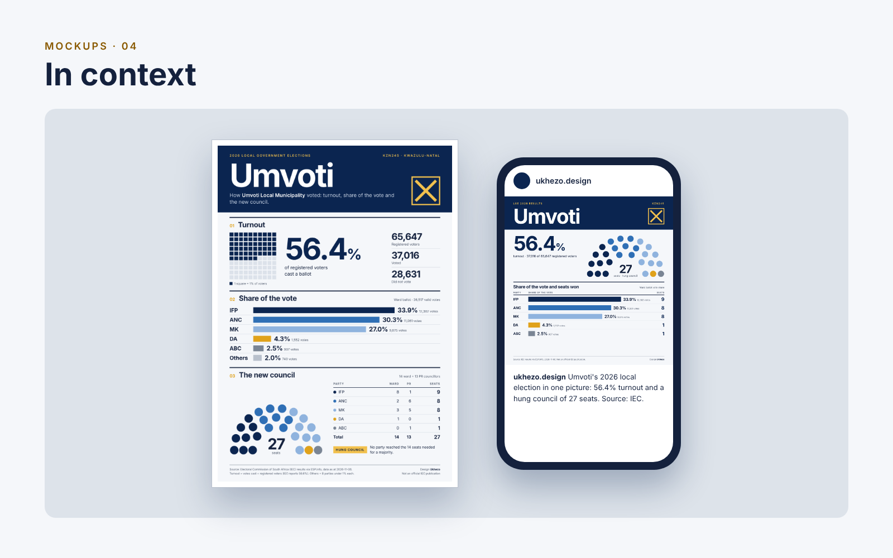
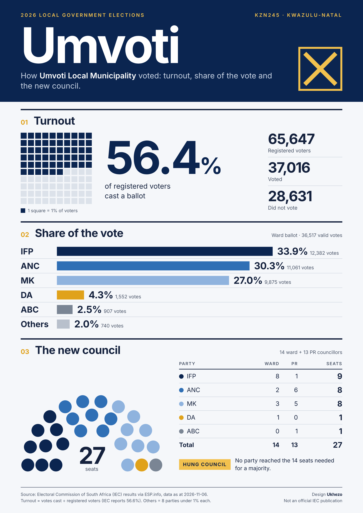
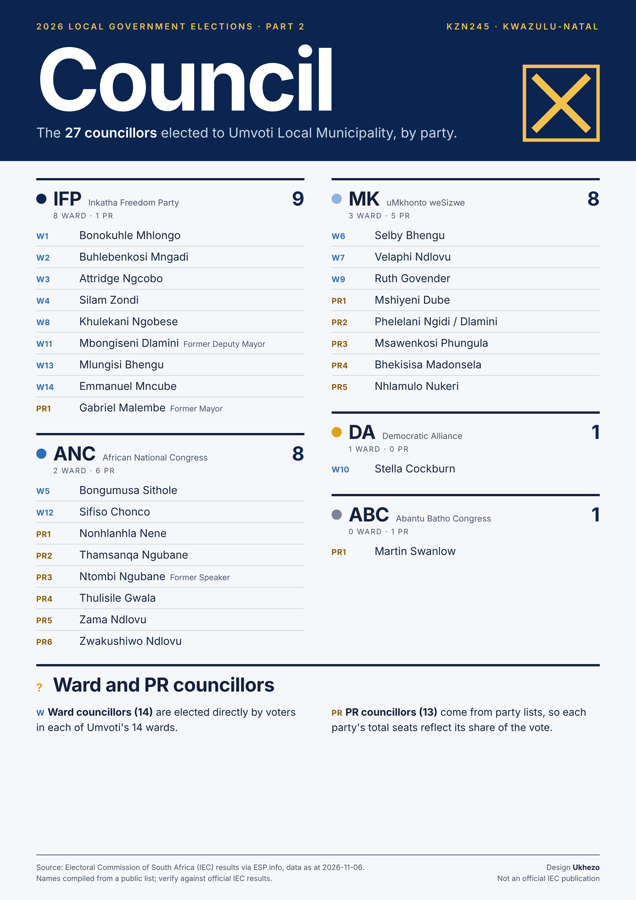
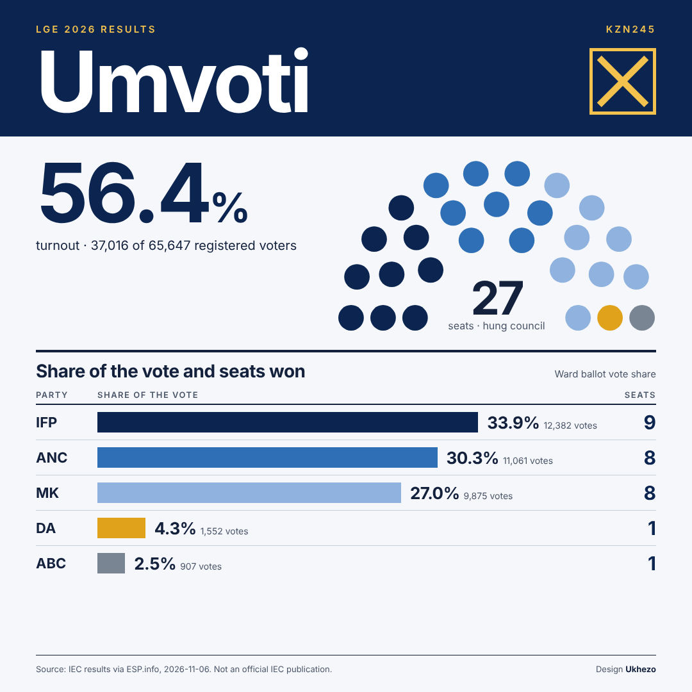
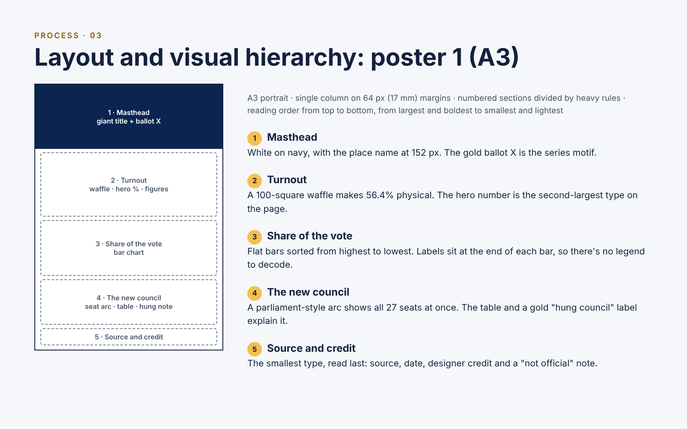
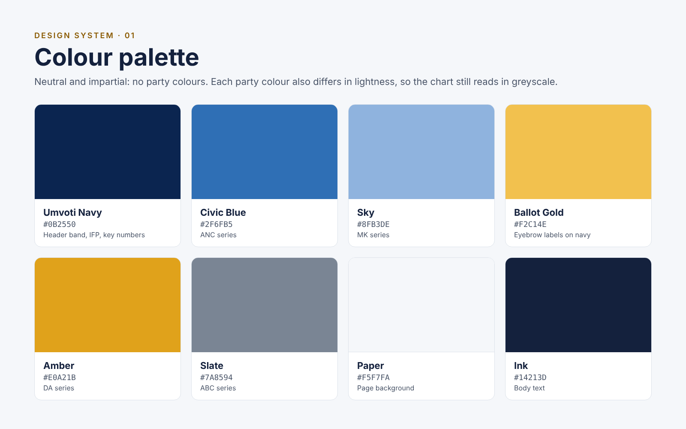
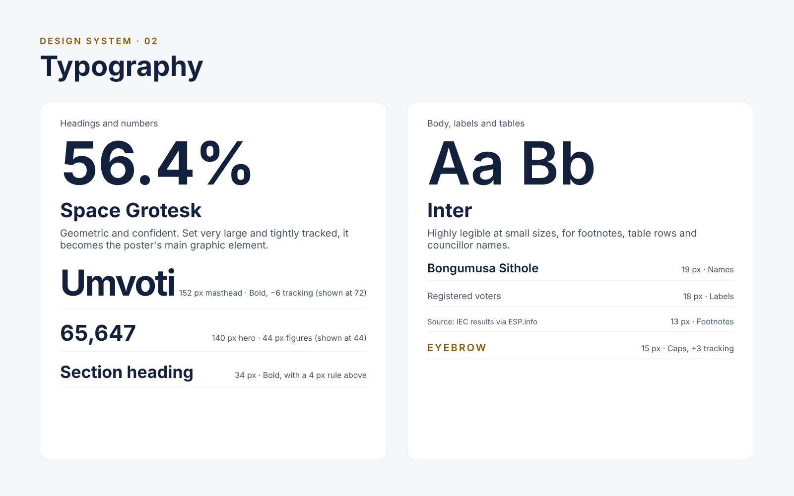

# Umvoti Votes 2026: Editorial Infographic Series

**Graphic design · Editorial design · Information design · Print**



An editorial poster series of three pieces that makes the **2026 Local Government Election results** for **Umvoti Local Municipality (KZN245)**, KwaZulu-Natal, quick to read, impartial and easy to share.

| | |
| --- | --- |
| **Role** | Graphic designer: content hierarchy, layout, typography, colour, data visualisation |
| **Deliverables** | 2 × A3 print posters (PDF + high-res PNG), 1 × Instagram post (1080 × 1080) |
| **Tools** | HTML and CSS for layout, Python for data and PNG export, Google Fonts |
| **Timeline** | November 2026 |

---

## The brief

Election results are usually published as long tables of numbers that most residents never read. The goal was to turn Umvoti's official results into graphics that:

1. Answer the top questions in a few seconds: *How many people voted? Who won? Who controls the council?*
2. Stay **politically neutral**, with no party colours, logos or loaded language.
3. Work both as a **printed poster** and as a **social media post** on a phone screen.
4. Are **trustworthy**, with every number traceable to the official source.

## The challenge

- **A hung council.** No party won a majority: IFP has 9 seats, ANC 8 and MK 8, with 14 needed. The design had to make *"nobody has 14"* instantly obvious.
- **Two kinds of councillor.** Ward councillors are elected directly and PR councillors come from party lists. Most people don't know the difference.
- **Very close numbers.** 33.9%, 30.3% and 27.0% are hard to compare as text.

## Final designs

| Poster 1: Umvoti (A3) | Poster 2: Council (A3) | Instagram square |
| :---: | :---: | :---: |
|  |  |  |
| Turnout, share of the vote and seats | All 27 councillors, ward and PR explained | One-glance summary for social media |

**Print files:** [Poster 1 PDF](designs/01-results-A3-print.pdf) · [Poster 2 PDF](designs/02-councillors-A3-print.pdf)

---

## Design process

### 1. Research and content hierarchy
I gathered the official results (registered voters, votes cast, votes per party, ward and PR seats) and ranked the information by what residents ask first:

> Turnout → who got the most votes → who controls the council → who my councillor is.

That order became the top-to-bottom flow of the page.

### 2. Layout, grid and visual hierarchy


- **Editorial style:** I chose a newspaper-style poster instead of a dashboard, so there are no rounded cards or boxes. Thin hairlines and heavy 4 px rules divide numbered sections (01, 02, 03).
- **Grid:** A3 portrait, single column on 64 px (17 mm) margins. The council section splits into a two-column chart and table.
- **Hierarchy:** the place name is the largest element at 152 px, then the 140 px turnout figure, then section heads, data and footnotes.
- **Motif:** a gold ballot "X" ties the series together and signals "election" without using any party symbol.

### 3. Colour palette


- **Neutral by design:** navy, blues, amber and slate, so no party's brand colours appear.
- **Accessible:** each series also differs in **lightness**, so the charts still read in greyscale and for colour-blind viewers.
- **Ballot Gold** is the only warm accent. It marks labels and the "hung council" status.

### 4. Typography


- **Space Grotesk** for headings and statistics: geometric, confident, with clear numbers at large sizes.
- **Inter** for body text, labels and names: very legible at small sizes.
- A dramatic type scale, from a 152 px masthead down to 13 px footnotes, makes the typography itself the main graphic.

### 5. Data visualisation choices

| Problem | Design solution |
| --- | --- |
| 56.4% turnout is abstract | **Waffle chart:** 100 squares with 56 filled, so you can see roughly half the voters turned out |
| Close vote shares are hard to compare | **Flat bar chart** sorted from highest to lowest, with labels at the end of each bar and no legend |
| "Hung council" is abstract | **Parliament arc:** 27 seats in a semicircle, coloured by party, with a gold "hung council" label |
| Ward and PR seats get confused | **Split table** on poster 1, **W/PR tags** and a short explainer on poster 2 |
| Trust | A **source and date** on every design, plus a "Not an official IEC publication" note |

### 6. Iteration
- **Version 1 (dashboard style):** rounded cards and boxes made the work look like an app screen, not a printed piece.
  **Version 2 (editorial):** I redesigned it as a print poster, with giant type, rules instead of boxes, numbered sections and the ballot X motif.
- **Fit:** the first editorial version ran past the A3 frame, and the giant turnout figure overlapped the numbers beside it. I reduced the hero size and tightened the section spacing until everything fit inside the margins.
- **Square post:** it was titled "share of the vote and seats" but didn't show seats. I added a seats column, which also filled the empty space at the bottom.

### 7. Mockups
I placed the A3 poster on a wall and the post on a phone screen (see the top of this page) to check the type is still legible at its real size.

## Output specifications

| Design | Size | Files | Use |
| --- | --- | --- | --- |
| Poster 1: Umvoti | A3 portrait, 297 × 420 mm | Vector PDF + PNG at 2246 × 3174 px | Print (notice boards, libraries) and web |
| Poster 2: Council | A3 portrait, 297 × 420 mm | Vector PDF + PNG at 2246 × 3174 px | Print and web |
| Instagram square | 1080 × 1080 px, 1:1 | PNG | Instagram and Facebook feed |

The PDFs are vector, so text and charts stay sharp at any size. They're RGB with no bleed, so a commercial print shop would need them converted to CMYK with 3 mm bleed first.

---

## Results at a glance

| | |
| --- | --- |
| Registered voters | **65,647** |
| Voters who voted | **37,016** |
| Turnout | **56.4%** (IEC reports 56.6%) |
| Council | **27 seats**: 14 ward + 13 PR, hung (14 needed) |

| Party | Vote % | Ward | PR | Seats |
| --- | ---: | ---: | ---: | ---: |
| IFP – Inkatha Freedom Party | 33.9% | 8 | 1 | **9** |
| ANC – African National Congress | 30.3% | 2 | 6 | **8** |
| MK – uMkhonto weSizwe | 27.0% | 3 | 5 | **8** |
| DA – Democratic Alliance | 4.3% | 1 | 0 | **1** |
| ABC – Abantu Batho Congress | 2.5% | 0 | 1 | **1** |

---

## Behind the design (technical)

The layouts are built in **HTML and CSS** and filled from one **data file** by a **Python** script, so the numbers are never typed by hand. One command rebuilds every design if the data changes.

```bash
python tools/build.py    # checks the data adds up and builds the pages in site/
python tools/export.py   # exports A3 PDFs, PNGs and process sheets (needs Chrome)
```

```
├── designs/      ← final artwork: A3 PDFs and PNGs
├── process/      ← palette, typography, layout and mockup sheets (src/ = editable HTML)
├── site/         ← HTML and CSS source of the designs
├── data/         ← umvoti_lge_2026.json, the single source of truth
└── tools/        ← build.py and export.py
```

## Sources and disclaimer

- Results come from the Electoral Commission of South Africa (IEC), [elections.org.za](https://www.elections.org.za), via ESP.info, with data as at 6 November 2026. Vote percentages are from the ward ballot.
- Councillor names were compiled from a public list and should be checked against official IEC results.
- This is a **personal portfolio project**, not an official IEC or Umvoti Municipality publication. No party logos or municipal insignia are used.

---

**Designed by Ukhezo** · [GitHub](https://github.com/Ukhezo)
